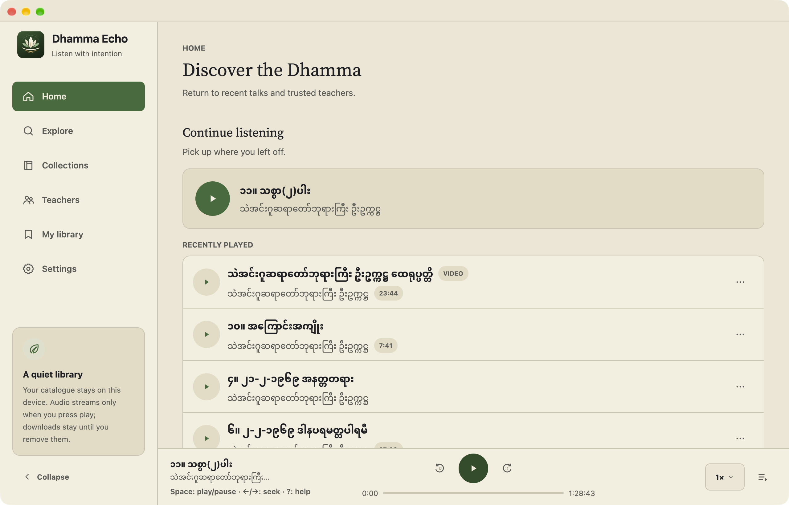
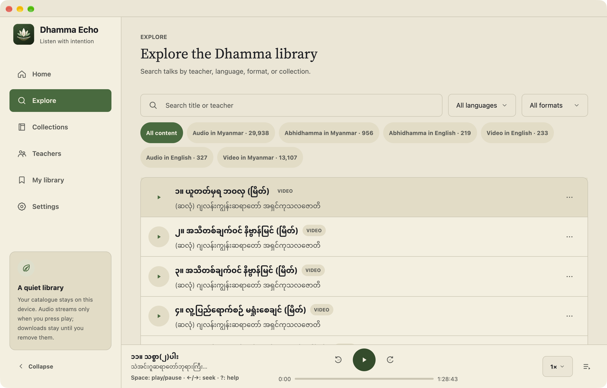
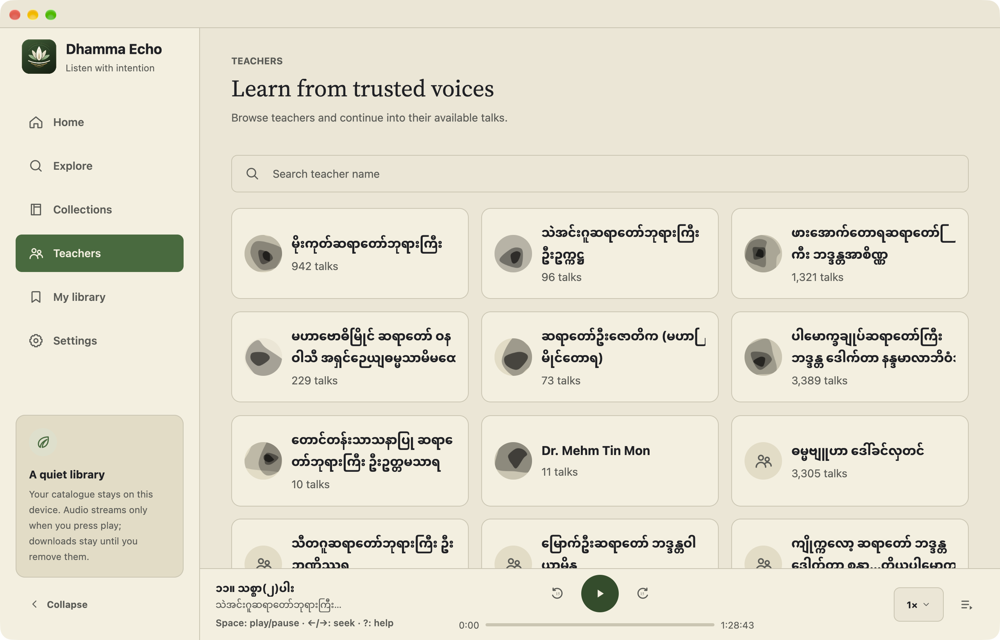
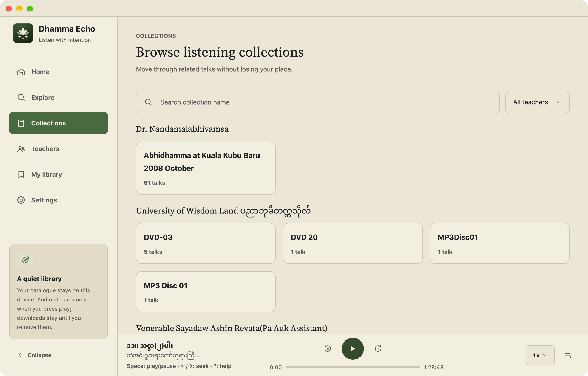
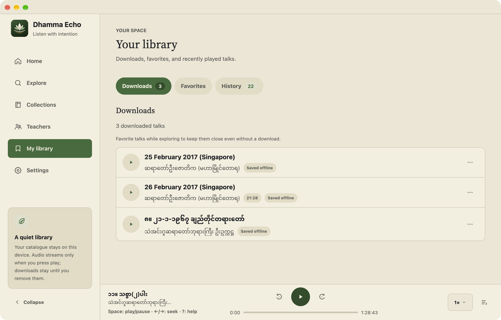
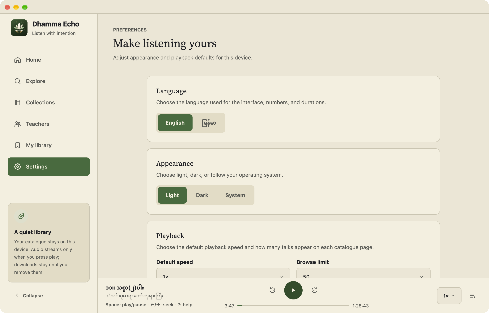
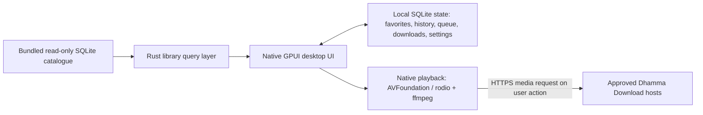

# Dhamma Echo

**Dhamma, without the noise.** A fast, private, pure-Rust desktop library for discovering, listening to, and resuming Myanmar Dhamma audio and video teachings — rewritten from the ground up with [GPUI](https://gpui.rs).

[](LICENSE)
[-3f6b3a.svg?style=flat-square)](https://gpui.rs)
[](https://www.rust-lang.org)
[](#install)



## Rewritten in Pure Rust with GPUI

Dhamma Echo was completely rewritten from Tauri + Svelte/WebView into a **100% native Rust application powered by [GPUI](https://gpui.rs)** (the GPU-accelerated UI framework built for Zed):

- **GPU-accelerated rendering** — direct Metal/native GPU compositing with no WebView, no Electron, no Node/JS runtime, and no DOM diffing overhead.
- **Instant launch & low memory** — opens immediately into the full 45,000+ record catalogue at a fraction of browser-based RAM usage.
- **Native media playback** — `AVFoundation` + `CVPixelBuffer` (`gpui::surface`) on macOS; pure-Rust `rodio` + `symphonia` audio and `ffmpeg`-backed video on Linux and Windows.
- **Seamless local upgrade** — automatically migrates favorites, history, queue, and resume positions from legacy Tauri installs via strictly read-only snapshot copies.

## Install

### macOS with Homebrew

```bash
brew install --cask AungMyoKyaw/homebrew-tap/dhamma-echo
```

Dhamma Echo is currently ad-hoc signed, so the Homebrew cask removes the quarantine attribute during installation. If macOS still blocks the first launch, right-click the app and choose **Open** once.

### macOS, Windows, and Linux installers

Download the latest macOS `.dmg`, Linux `.tar.gz` / `.deb`, or Windows `.exe` / `.zip` from [GitHub Releases](https://github.com/AungMyoKyaw/dhamma-echo/releases).

## What Dhamma Echo is

Dhamma Echo turns a large Dhamma catalogue into a quiet desktop library instead of a feed. It helps you find a teaching, play a compatible source file, keep your place, and return later without creating an account.

| Catalogue         | Current index |
| ----------------- | ------------: |
| Audio talks       |    **30,563** |
| Video records     |    **14,474** |
| Teachers          |       **257** |
| Audio collections |       **429** |

The application does **not** host those media files. It catalogs records sourced from [Dhamma Download](https://www.dhammadownload.com/) and requests compatible media from the approved Dhamma Download hosts when you choose to play it. See [Data and licensing](#data-and-licensing) before redistributing catalogue data or media references.

## Built as a library, not a feed

- **Find what you came for.** Instant search across titles and teachers (with Myanmar Unicode normalization), plus filters by category, collection, teacher, language, and format.
- **Listen without losing context.** Persistent player bar while browsing, with seek, 15-second jumps, playback speed, queue management, offline MP3 downloads, and per-talk resume positions.
- **Audio and video share one library.** History, favorites, queue state, and resume positions work across supported MP3 audio and MP4 video.
- **English and Myanmar UI.** Native bilingual localization (`en-US` and `my-MM`) with bundled Source Serif 4 headings.
- **Return where you left off.** Recent listening activity and saved state stay on the device in a local SQLite database.
- **Keep personal activity private.** No accounts, analytics, ads, telemetry, or cloud sync.

## See the product

| Explore                                                                          | Teachers                                            |
| -------------------------------------------------------------------------------- | --------------------------------------------------- |
|  |  |

| Collections                                               | My library                                                                  |
| --------------------------------------------------------- | --------------------------------------------------------------------------- |
|  |  |

| Home                               | Settings                                                      |
| ---------------------------------- | ------------------------------------------------------------- |
|  |  |

## Playback and catalogue behavior

Dhamma Echo keeps catalogue visibility separate from playback capability.

| Source format | Searchable | In-app playback                |
| ------------- | ---------- | ------------------------------ |
| MP3           | Yes        | Yes, from approved HTTPS hosts |
| MP4           | Yes        | Yes, from approved HTTPS hosts |
| WMA           | Yes        | Not playable natively          |
| WMV           | Yes        | Not playable natively          |

For playable records, the app normalizes and encodes catalogue URLs, strips credentials/ports/fragments, upgrades approved same-host HTTP URLs to HTTPS, and retries between `www.dhammadownload.com` and `dhammadownload.com`. A source file removed or blocked by the remote service cannot be recovered by the app.

## Privacy by architecture

Your personal listening state stays on your machine in a local SQLite database (`state.sqlite`). The bundled catalogue (`resources/dhamma.db`) is opened strictly read-only (`PRAGMA query_only = true`). There is no account backend and no analytics or telemetry service.



Security boundaries:

- `resources/dhamma.db` opens strictly read-only (`PRAGMA query_only = true`) and every SQL query is parameterized.
- All remote media streaming and MP3 downloads are restricted to HTTPS on approved `dhammadownload.com` hosts.
- Legacy Tauri migration reads only from temporary snapshot copies — never mutating legacy database files.
- Personal library state never leaves your device.
- Security issues should be reported through [SECURITY.md](SECURITY.md), not a public issue.

Read the published [privacy policy](docs/privacy/).

## Architecture & Technology

- **UI Framework:** [GPUI](https://gpui.rs) (`gpui 0.2.2`), pure Rust 2024 edition
- **Catalogue & State:** `rusqlite` with bundled SQLite (`resources/dhamma.db` read-only, `state.sqlite` per-user)
- **macOS Playback:** `AVFoundation` + `AVPlayerItemVideoOutput` (`420f` `CVPixelBuffer` rendered directly to `gpui::surface`)
- **Linux & Windows Playback:** Pure-Rust `rodio` + `symphonia-mp3` audio, plus `ffmpeg`-backed video frames & PCM audio
- **Networking:** `reqwest` with `rustls-tls` restricted to approved `dhammadownload.com` hosts
- **Icon & Brand Masters:** Native VectorCraft masters in `assets/dhamma-echo-icon.vectorcraft` and `assets/dhamma-echo-brand.vectorcraft`

## Run from source

### Requirements

- Rust 1.85+ with Cargo and `rustfmt` (pinned via `Cargo.lock` — always pass `--locked`)
- **macOS:** Xcode Command Line Tools (macOS 13+)
- **Linux:** Standard GPUI/Vulkan/X11/Wayland dev packages + `ffmpeg` (optional, for MP4 video)
- **Windows:** MSVC build tools + `ffmpeg` (optional, for MP4 video)

### Clone and run

```bash
git clone https://github.com/AungMyoKyaw/dhamma-echo.git
cd dhamma-echo
make dev
```

### Useful commands

| Command                                       | Purpose                                                           |
| --------------------------------------------- | ----------------------------------------------------------------- |
| `make dev`                                    | Run Dhamma Echo in development (`cargo run --locked`)             |
| `make build`                                  | Build optimized release binary (`cargo build --release --locked`) |
| `make test`                                   | Run Rust unit tests (`cargo test --locked`)                       |
| `make lint`                                   | Run `cargo fmt -- --check` and `cargo clippy ... -D warnings`     |
| `make verify`                                 | Full verification gate (`format`, `clippy`, `tests`)              |
| `make package-macos`                          | Build ad-hoc signed macOS `.app` bundle and `.dmg` installer      |
| `make package-linux`                          | Build Linux `.tar.gz` tarball and `.deb` package                  |
| `pwsh -File scripts/package-windows.ps1`      | Build Windows release archive                                     |
| `cargo run --release --locked -- --self-test` | Run end-to-end catalogue and playback self-test                   |

## Configuration and storage

- `resources/dhamma.db` is bundled as an immutable read-only SQLite resource (tracked via Git LFS).
- Favorites, history, queue, offline downloads, settings, and resume positions are stored locally in your platform's native application data directory.
- Source Serif 4 (display font for page and section headings) is bundled in `assets/fonts/`. Myanmar text uses installed system fonts (`Noto Sans Myanmar`, `Myanmar Text`, `Pyidaungsu`).

## Data and licensing

The source code and original project assets are licensed under the [PolyForm Noncommercial License 1.0.0](https://polyformproject.org/licenses/noncommercial/1.0.0). The bundled `dhamma.db`, catalogue metadata, remote media, teacher names, and teachings are **not relicensed by this repository**.

Read [DATA_LICENSE.md](DATA_LICENSE.md) before public redistribution. Source media and catalogue records originate from [Dhamma Download](https://www.dhammadownload.com/); availability and rights remain with their respective source/rights holders.

## Contributing

Read [CONTRIBUTING.md](CONTRIBUTING.md), follow the [Code of Conduct](CODE_OF_CONDUCT.md), and run `make verify` before opening a pull request.

For release history, see [CHANGELOG.md](CHANGELOG.md). For security reporting, see [SECURITY.md](SECURITY.md).

## License

**License:** PolyForm Noncommercial 1.0.0 — free for personal and noncommercial use. Commercial use requires separate permission.

Copyright (c) 2026 Aung Myo Kyaw.

The [PolyForm Noncommercial License 1.0.0](https://polyformproject.org/licenses/noncommercial/1.0.0) applies to the source code and original project assets. See [LICENSE](LICENSE) and [DATA_LICENSE.md](DATA_LICENSE.md).
